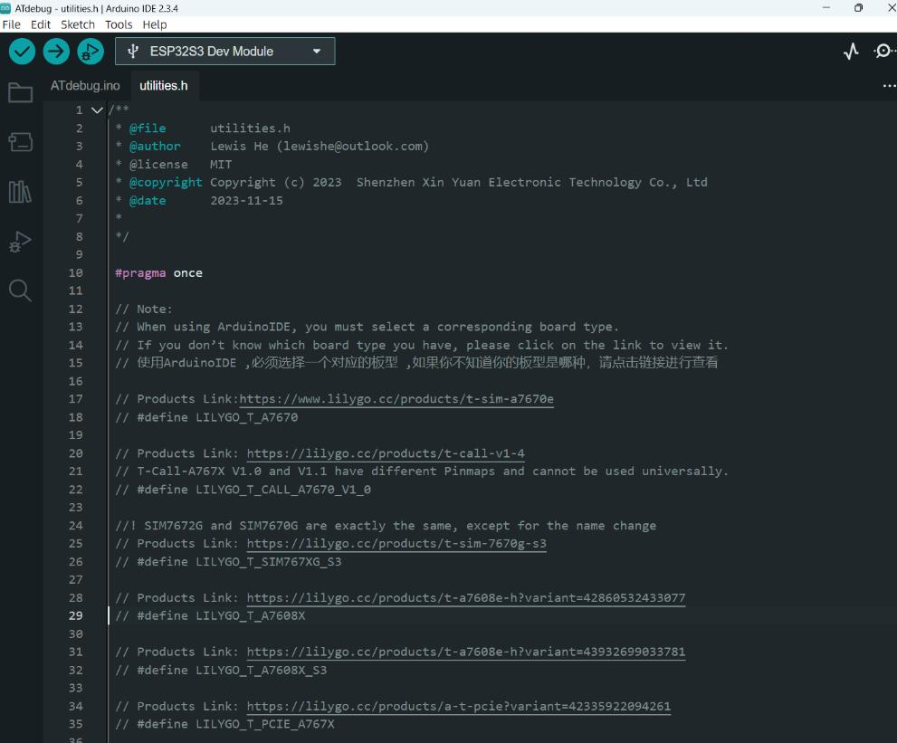

[English](../../../en/esp32/t-call-a7670x/README.MD) | [中文](./README.MD)

  

<h1 align = "center">🌟LilyGo T-Call A7670X ESP32 版本🌟</h1>

## 概述

* This page introduces the hardware parameters related to `LilyGo T-Call A7670X ESP32 版本`

### 产品

| Product                   | SOC            | Flash         | PSRAM         |
| ------------------------- | -------------- | ------------- | ------------- |
| [T-Call A7670E ESP32][1]  | ESP32-WROVER-E | 4MB(Quad-SPI) | 8MB(Quad-SPI) |
| [T-Call A7670SA ESP32][1] | ESP32-WROVER-E | 4MB(Quad-SPI) | 8MB(Quad-SPI) |
| [T-Call A7670G ESP32][1]  | ESP32-WROVER-E | 4MB(Quad-SPI) | 8MB(Quad-SPI) |

[1]: https://www.lilygo.cc/products/t-call-v1-4

> \[!IMPORTANT]
> There are two versions of T-Call A7670X. Please be careful to distinguish them. Please check the silkscreen on the front of the board to distinguish them.
> T-Call A7670X 有两个版本,请注意区分，如何区分请查看板子正面丝印.
> 

### 模块差异

| 型号           | GPS | 电话 | SMS | Frequency band                                                                                                     |
| --------------- | --- | ---------- | --- | ------------------------------------------------------------------------------------------------------------------ |
| A7670E-FASE     | ✅   | ✅          | ✅   | LTE-FDD:B1/B3/B5/B7/B8/B20  GSM:900/1800                                                                           |
| A7670SA-FASE    | ✅   | ✅          | ✅   | LTE-FDD:B1/B2/B3/B4/B5/B7/B8/B28/B66  GSM:850/900/1800/1900                                                        |
| A7670E-LNXY-UBL | ❌   | ❌          | ❌   | LTE-FDD:B1/B3/B5/B7/B8/B20                                                                                         |
| A7670SA-LASE    | ❌   | ✅          | ✅   | LTE-FDD:B1/B2/B3/B4/B5/B7/B8/B28/B66  GSM:850/900/1800/1900                                                        |
| A7670SA-LASC    | ❌   | ✅          | ✅   | LTE-FDD:B1/B2/B3/B4/B5/B7/B8/B28/B66  GSM:850/900/1800/1900                                                        |
| A7670G-LLSE     | ❌   | ✅          | ✅   | LTE-FDD:B1/B2/B3/B4/B5/B7/B8/B20/B28/B66  LTE-TDD:B34/B38/B39/B40/B41 GSM:850/900/1800/1900                        |
| A7670G-LABE     | ❌   | ✅          | ✅   | LTE-FDD:B1/B2/B3/B4/B5/B7/B8/B12/B13/B18/B19/B20/B25/B26/B28/B66 LTE-TDD:B34/B38/B39/B40/B41 GSM:850/900/1800/1900 |
| A7670E-LASE     | ❌   | ✅          | ✅   | LTE-FDD:B1/B3/B5/B7/B8/B20  GSM:900/1800                                                                           |

> \[!IMPORTANT]
> 如何检查模块的具体型号版本？发送 AT+SIMCOMATI 可以返回使用的固件版本和硬件版本。
>
> 请注意，GNSS IPEX 天线连接器是否在 PCB 上取决于实际的模块版本。 The A7670G modem does not have internal GPS functionality, regardless of whether GPS is included in your order. If you purchased the A7670G with GPS, you will need to use an external GPS module.

### PlatformIO 快速入门

1. 首次使用需安装 **CH9102 USB 桥接** 驱动。
   * [Windows](https://www.wch-ic.com/downloads/CH343SER_ZIP.html)
   * [Mac OS](https://www.wch-ic.com/downloads/CH34XSER_MAC_ZIP.html)
2. 安装 [Visual Studio Code](https://code.visualstudio.com/) 和 [Python](https://www.python.org/)
3. 在 `Visual Studio Code` 扩展中搜索 `PlatformIO` 插件并安装。
4. 安装完成后，需要重启 `Visual Studio Code`
5. 重启 `Visual Studio Code` 后，选择左上角的 `文件` -> `打开文件夹` -> 选择 `LilyGo-Modem-Series` 目录
6. 等待第三方依赖库安装完成
7. 点击 `platformio.ini` 文件，在 `platformio` 栏中
8. Cancel the `;` symbol in front of the line `default_envs = default_envs = T-Call-A7670X-V1-0` and use `default_envs = T-Call-A7670X-V1-0` as the default environment , If you are using V1.1, then select `default_envs = T-Call-A7670X-V1-1`
9. 取消注释 `src_dir = xxxx` 中的一行，确保只有一行有效。例如，要启用 `src_dir = examples/ATdebug`，删除前面的 `;` 符号并保存文件。现在将编译 ATDebug 示例。
10. 点击左下角的 (✔) 符号进行编译
11. Connect the board to the computer USB-C , Micro-USB is used for module firmware upgrade
12. 点击 (→) 上传固件
13. 点击（插头符号）监控串口输出
14. 如果无法写入，或 USB 设备持续闪烁，请查看下方的 **常见问题**

### Arduino IDE 快速入门

1. 首次使用需安装 **CH9102 USB 桥接** 驱动。
   * [Windows](https://www.wch-ic.com/downloads/CH343SER_ZIP.html)
   * [Mac OS](https://www.wch-ic.com/downloads/CH34XSER_MAC_ZIP.html)
2. 安装 [Arduino IDE](https://www.arduino.cc/en/software)
3. 安装 [Arduino ESP32](https://docs.espressif.com/projects/arduino-esp32/en/latest/)
4. 将 `lib` 目录中的所有文件夹复制到 `Sketchbook location` 目录。如何找到您自己的库位置，[请查看这里](https://support.arduino.cc/hc/en-us/articles/4415103213714-Find-sketches-libraries-board-cores-and-other-files-on-your-computer)
    * Windows: `C:\Users\%USERNAME%\Documents\Arduino\libraries`
    * MacOS: `$HOME/Documents/Arduino/libraries`
    * Linux: `$HOME/Arduino/libraries`
5. 打开相应的示例
    * 打开下载的 `LilyGo-Modem-Series`
    * 打开 `examples`
    * 选择示例文件并打开以 `ino` 结尾的文件
6. 在 Arduino IDE 中，在工具项目中选择相应的开发板，点击下方列表中的相应选项进行选择

    | 名称                                 | 值                                |
    | ------------------------------------ | ------------------------------------ |
    | Board                                | **ESP32 Dev Module**                 |
    | Port                                 | 您的端口                            |
    | CPU Frequency                        | 240MHZ(WiFi/BT)                      |
    | Core Debug Level                     | None                                 |
    | Erase All Flash Before Sketch Upload | Disable                              |
    | Events Run On                        | Core1                                |
    | Flash Frequency                      | 80MHZ                                |
    | Flash Mode                           | QIO                                  |
    | Flash Size                           | **4MB(32Mb)**                        |
    | JTAG Adapter                         | Disabled                             |
    | Arduino Runs On                      | Core1                                |
    | Partition Scheme                     | **Huge APP (3MB No OTA/1MB SPIFFS)** |
    | PSRAM                                | **Enable**                           |
    | Upload Speed                         | 921600                               |
    | Programmer                           | **Esptool**                          |

     * `Partition Scheme` 请根据实际应用选择。例如选择 **Huge APP (3MB No OTA/1MB SPIFFS)** , 更多分区方案请查看[这里](https://docs.espressif.com/projects/esp-idf/en/stable/esp32/api-guides/partition-tables.html)

7. In the open sketch, select the `utilities.h` file and uncomment the line `// #define LILYGO_T_CALL_A7670_V1_0`. Delete the `//` and save the file to use this board as the default configuration, If you are using V1.1, then select `#define LILYGO_T_CALL_A7670_V1_1`

   

8. 上传 sketch

> \[!IMPORTANT]
>
> 1. 无法上传任何代码？请查看下方的常见问题
> 2. 打开 Arduino IDE 时，会提示有新的库可以更新。请点击不更新。更新后无法保证能够编译、运行等。请确保开发板正常运行后再决定是否更新。要知道由于库的差异，更新后可能会出现问题，或者默认配置（如 TinyGSM）将被覆盖。
> 3. 如果更新后运行异常，请按照 Arduino 快速入门第 4 条删除 libraries 中的目录，并将 lib 中的文件夹重新拖入 libraries 目录。

### 📍 Pins Map

| 名称         | V1.0 | V1.1 |
| ------------ | ---- | ---- |
| Modem TX     | 26   | 27   |
| Modem RX     | 25   | 26   |
| Modem PWRKEY | 4    | 4    |
| Modem RESET  | 27   | 5    |
| Modem RING   | 13   | 33   |
| Modem DTR    | 14   | 32   |
| Board LED    | 12   | 13   |

> \[!IMPORTANT]
> V1.0 and 1.1 use completely different pins, please pay attention to distinguish the versions
> ESP32 型号 GPIO33 及以上只能设置为输入，不能设置为输出
> How to distinguish V1.0 from 1.1, check the silk screen on the PCB, which has the version information sprayed on it

### ⚡ Electrical parameters

| 特性             | 详情 |
| -------------------- | ------- |
| 🔗USB-C 输入电压 | 5V      |

> \[!TIP]
>
> T-Call 没有电池接入功能，只能通过 USB-C 供电
>

### 按钮说明

| 按钮    | 功能                            |
| --------- | ----------------------------------- |
| BOOT      | 可自定义功能/下载模式 |
| RST       | 复位设备按钮                |
| 7670_BOOT | 模块升级模式                  |

* Press and hold the `BOOT` button before powering on. The board is now in waiting mode for downloading.
* Before powering on, keep the `7670_BOOT` button pressed to put the modem into firmware update mode.
* 以上命名方式以开发板丝印为准

### 天线说明

|      | 功能                     |
| ---- | ---------------------------- |
| MAIN | LTE 主天线接口   |
| GPS  | GPS 有源天线接口 |

* 以上命名方式以开发板丝印为准

### LED 说明

| 功能            | 颜色                  |
| ------------------- | ---------------------- |
| 模块状态        | RED   (Near the modem) |
| 模块网络状态 | RED   (Near the modem) |

* 模块状态灯和网络状态灯无法关闭

### 语音通话功能

* 连接麦克风和扬声器即可使用语音通话功能。
* 将 1W 扬声器连接到 SPK+/SPK-
* 将驻极体麦克风连接到 MIC+/MIC-

### 资源

* [GPS 天线](../../../../datasheet/GPS%20Antenna%20Specifications.pdf)
* [LTE 天线](../../../../datasheet/LTE%20Antenna%20Specifications.pdf)
* [T-Call-A7670-V1.0 原理图](../../../../schematic/esp32/T-Call-A7670-V1.0.pdf)
* [T-Call-A7670-V1.1 原理图](../../../../schematic/esp32/T-Call-A7670-V1.1.pdf)
* [SIMCOM 官方 A7670X 全部数据手册](https://cn.simcom.com/product/A7670X.html)
* [For A7670X series documentation，请访问 datasheet 目录。](../../../../datasheet/A7670X/)
* [开发板尺寸](../../../../dimensions/esp32/T-Call-A7670-ESP32.dxf)

### 常见问题

* **如果以上方法仍然无法上传 sketch，请按照以下方法测试 USB2TTL 通信是否正常。**
  1. 将 USB-C 连接到 PC
  2. 打开串口监视器，将波特率调整为 115200
  3. 按下开发板上的 RST 按钮重启
  4. 如果能看到启动信息，说明 USB2TTL 通信正常。如果串口监视器中没有任何显示，可能是 USB2TTL 桥接损坏

* **升级模块固件**
  1. [T-A76XX 升级文档](../../../../docs/update_fw.md) / [Video](https://youtu.be/AZkm-Z7mKn8)
  2. [Upgrade firmware issue](https://github.com/Xinyuan-LilyGO/LilyGo-Modem-Series/issues/180)

* **无法检测到 SIM 卡？**
   1. 需要先将 SIM 卡插入开发板，然后再开机检测 SIM 卡。如果顺序颠倒，将报告无法检测到 SIM 卡。

* **无法上传任何 sketch，请手动进入上传模式。**
   1. 通过 USB 线连接开发板
   2. Press and hold the **BOOT** button , While still pressing the **BOOT** button
   3. Press **RST** button
   4. Release the **RST** button
   5. Release the **BOOT** button
   6. 上传 sketch

* **关于 VBUS 引脚**
  1. VBUS 引脚和 USB-C 在同一条线上。只有连接 USB-C 时，VBUS 才有电压
  2. 如果想连接外部电源而不连接 USB-C，VBUS 引脚是唯一的电压输入引脚。请注意，VBUS 引脚的最大输入为 5V，不要超过 5V

* 可以使用其他 GPS 天线吗？
  1. 外部 GPS 天线必须是 3.3V 供电的有源 GPS 天线。 For example, the [MK-76](https://www.rfmw.com/datasheets/sanav/mk-76.pdf) 支持 2.5-5.5V，兼容。大多数有源 GPS 天线支持 2.5-5.5V 供电。详情请参考 GPS 天线数据手册。
