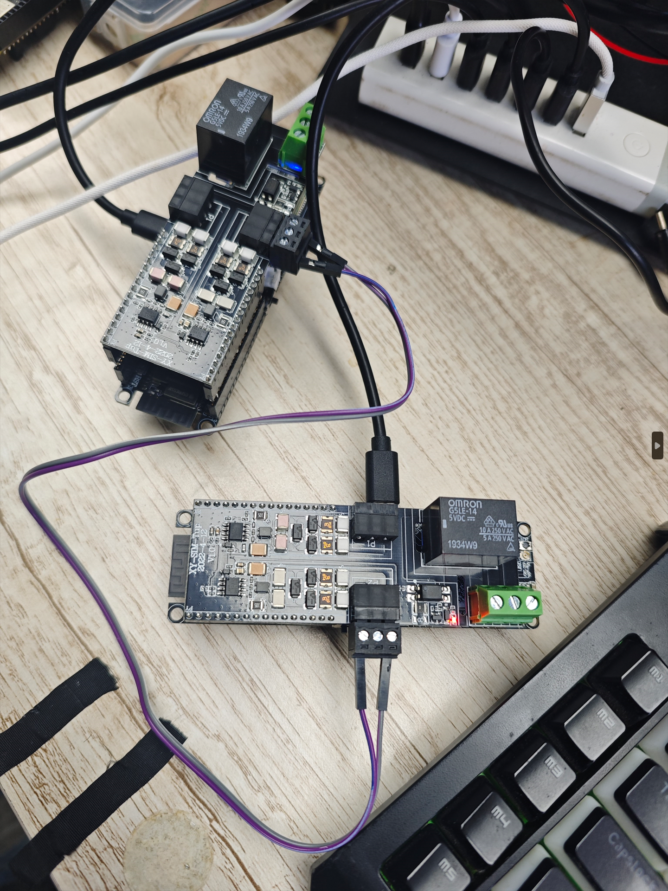
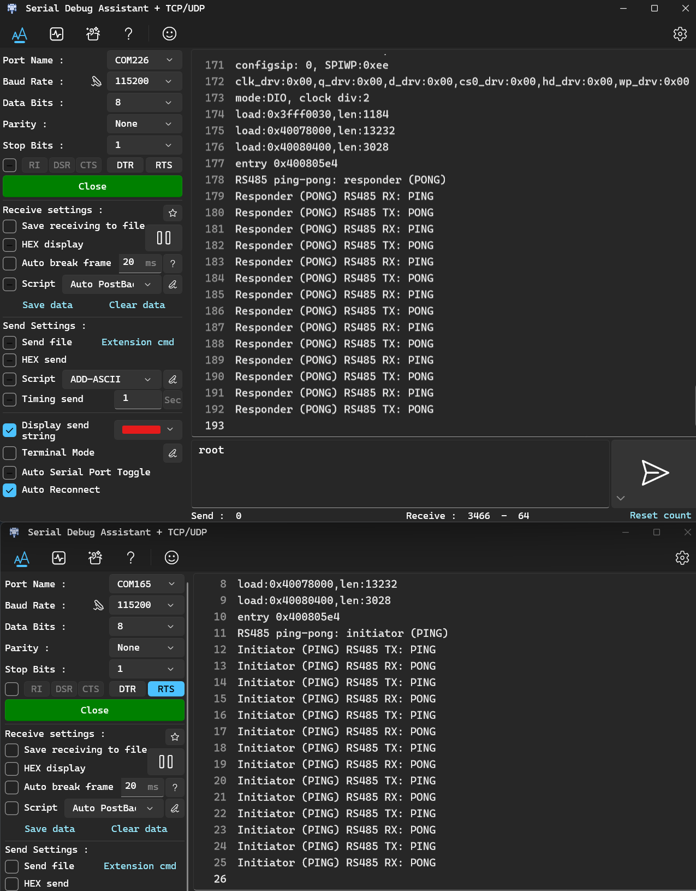

## Firmware

- Double-click `firmware/flash_ping_example.bat` to flash "ping".
- Double-click `firmware/flash_pong_example.bat` to flash "pong".

- Ensure that only one board is connected at a time when performing a flash operation.

## Diagram

## Serial monitor

